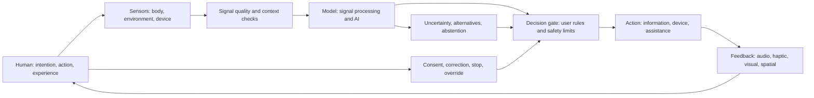

# Beyond the Screen
## Human interaction with electrical, biological, and computational systems

**Mirror Cartographer — research direction**  
**Originating project:** Charity Sturgell  
**Status:** Literature-grounded research agenda; not a device specification or clinical claim  
**Version:** 1.0 · 30 October 2026

---

## 1. The assumption to challenge

Modern consumer technology makes a particular interaction pattern feel inevitable:

1. a person looks at a screen;
2. the person touches, types, or speaks to a device;
3. software processes the input;
4. information appears on the screen.

This is one interface pattern. It is not the definition of human–technology interaction, and it is not the only way a person can interact with electrical systems.

A phone is an electrical device. A computer is an electrical device. But the human body is also an electrochemical system. Nerve cells communicate through changes in membrane voltage and chemical signaling; muscles respond to neural activation; sensory systems convert physical stimuli into neural activity. This does not mean the body is simply a machine or that all human experience can be reduced to electricity. It means there are measurable physical processes through which technology can sometimes exchange information with the body.

**The research question is not merely how to make screens easier to use. It is how to design safe, consensual, useful interaction between people and technological systems across multiple sensory, motor, biological, and environmental channels.**

## 2. Four different meanings of “interacting with electricity”

These categories must not be collapsed.

### A. Using electrical devices
Phones, computers, radios, appliances, vehicles, lighting, and industrial equipment. The person usually interacts through physical controls, displays, voice, or networked services.

### B. Measuring electrical activity
Sensors can record electrical or electrical-related signals, including:
- EEG: scalp-recorded electrical activity associated with brain activity;
- EMG: electrical activity associated with muscle activation;
- ECG: electrical activity associated with cardiac cycles;
- electrodermal activity: changes in skin conductance associated with sweat-gland activity;
- other biopotential and bio-impedance measurements.

Measurement is not mind-reading. Signals are noisy, context-dependent, affected by movement and environment, and rarely map one-to-one onto a complex mental state.

### C. Applying electrical or electromagnetic stimulation
Some technologies deliver controlled energy to influence tissue or neural activity. Examples include transcutaneous electrical nerve stimulation (TENS), functional electrical stimulation (FES), transcranial electrical stimulation, and transcranial magnetic stimulation (TMS). These methods differ in mechanism, target, dose, evidence, risks, and clinical indication. They are not interchangeable, and stimulation is not a general-purpose way to control or repair the body.

### D. Translating signals into interaction
A system may use physiological or behavioral signals as input, interpret them, and trigger an output: a cursor, communication aid, robotic device, environmental control, or feedback signal. This is the broad field of human–computer interaction, human–machine interaction, and brain–computer interfaces.

The key distinction: a system may **sense** a signal, **infer** something from it, and **act** on that inference. Each step introduces uncertainty and requires separate validation.

## 3. Interaction does not have to be screen-first

| Interaction channel | Example | What it can enable | Main constraints |
|---|---|---|---|
| Audio | Speech, sound cues, spoken output | Hands-free communication and navigation | Noise, privacy, hearing, language |
| Tactile / haptic | Vibration, pressure, texture | Quiet alerts, directional or state feedback | Sensory differences, ambiguity, comfort |
| Gesture / movement | Hand, head, posture, body movement | Control without a handheld device | Motor access, fatigue, accidental activation |
| Gaze / facial movement | Eye tracking, blink or facial gesture | Access for some people with limited limb movement | Calibration, fatigue, lighting, privacy |
| Physical switches | Buttons, sip-and-puff, adaptive controls | Reliable intentional input | Placement, availability, setup |
| Environmental sensing | Location, light, sound, temperature, motion | Context-aware assistance | Surveillance, false triggers, context errors |
| Physiological sensing | EEG, EMG, ECG, PPG, skin conductance | Assistive control, biofeedback, state estimation | Signal quality, individual variation, interpretation limits |
| Neural interfaces | Non-invasive or implanted BCI | Communication or control where conventional channels are limited | Training, reliability, invasiveness, safety, cost |
| Spatial / robotic interfaces | Haptic or robotic assistance | Physical assistance and embodied interaction | Safety, latency, control authority, maintenance |

A screen may still be useful. The point is to stop treating it as mandatory.

## 4. What current research establishes

Non-invasive brain–computer interfaces can record neural activity and decode selected signal patterns for communication or control. A 2025 IEEE Reviews in Biomedical Engineering review describes progress beyond simple cursor tasks toward control of robotic devices, while also detailing signal acquisition, decoding, and algorithmic challenges. This is a research field, not a universal consumer capability.

A 2025 review of biopotential and bio-impedance for human–robot interaction describes how physiological signals can help estimate movement intention in real time. It also emphasizes inter-person variability, noise, and the need for hybrid sensing approaches.

A 2025 review of hybrid EEG-based interfaces examined 124 studies using EEG alongside other signals such as eye movement, muscle activity, and functional near-infrared spectroscopy. It reports opportunities for multimodal decoding while identifying unresolved problems including real-time operation, synchronization, limited data, and explainability.

A 2026 review of sensing technologies for silent speech interfaces describes off-body, on-body, and in-body approaches, and discusses the role of multimodal sensing and edge AI. Silent-speech systems are a useful example of interaction that is not dependent on audible speech or a conventional keyboard, but their accuracy, comfort, privacy, and practical deployment remain modality- and user-specific.

Sources:
- Edelman et al. (2025), “Non-Invasive Brain-Computer Interfaces: State of the Art and Trends,” *IEEE Reviews in Biomedical Engineering*. https://doi.org/10.1109/RBME.2024.3449790
- “Using biopotential and bio-impedance for intuitive human–robot interaction,” *Nature Reviews Electrical Engineering* (2025). https://doi.org/10.1038/s44287-025-00191-5
- Lee et al. (2025), “A review of hybrid EEG-based multimodal human-computer interfaces using deep learning,” *Biomedical Engineering Letters*. https://doi.org/10.1007/s13534-025-00469-5
- “Sensing technologies for silent speech interfaces,” *Nature Sensors* (2026). https://doi.org/10.1038/s44460-025-00010-2

## 5. What AI brings to the table

AI does not supply the electrical connection. Sensors, electrodes, transducers, circuits, actuators, and communication hardware do that. AI can help interpret and coordinate what happens around that connection.

### Signal interpretation
Physiological signals vary across people and across time. Machine-learning methods can extract patterns from noisy, high-dimensional data. The output remains a model estimate, not direct access to a person's thoughts or intentions.

### Multimodal fusion
A system can combine signals that compensate for one another's weaknesses—for example, muscle activity, eye movement, inertial movement, and neural signals. Fusion may improve robustness, but only if the modalities are synchronized, independently validated, and appropriate for the task.

### Personal calibration
Instead of assuming one signal pattern applies to everyone, a model can learn an individual's baseline and adapt to drift. This raises questions about how much data is required, how often recalibration is needed, and whether the user can inspect or reset the model.

### Translation across channels
AI can translate speech to text, text to speech, gesture to commands, or selected neural and muscular patterns into assistive control. Translation should preserve ambiguity and provide confirmation when an incorrect action could cause harm.

### Closed-loop adaptation
A closed-loop system can observe a signal, estimate a state, choose a constrained action, measure the response, and adjust. This is different from a one-way device that only records data. Any adaptive system needs safety bounds, user override, transparent state, and a reliable stop mechanism.

### Explanation and uncertainty
AI could show which signal features influenced an output, what alternative interpretations exist, how confident the model is, and when it should abstain. Explainability is not solved simply by generating a fluent explanation; it requires testable correspondence between the explanation and the model's behavior.

## 6. The interaction loop MC should study

This is a conceptual architecture, not a claim that all components are available or validated in one system.

### Required properties
- The user can understand when sensing is active.
- Consent is specific, revocable, and not bundled with unrelated access.
- The user can correct the interpretation and see what changes.
- The system distinguishes raw measurement, processed feature, model inference, and action.
- High-consequence actions require appropriate human confirmation.
- The user can stop the interaction and return to a non-adaptive mode.
- Data collection is minimized, locally processed where practical, and governed by clear retention and deletion rules.
- The interface supports people who cannot or do not want to use a screen, voice, or a particular sensor.

## 7. The body is not merely another input device

A critical conceptual boundary: a person is not a peripheral attached to a computer.

A human signal may be involuntary, ambiguous, medically relevant, emotionally meaningful, or unrelated to the task. A system must not assume that a change in heart rate, skin conductance, facial expression, or neural activity reveals a specific emotion, preference, intention, or truth.

The person's own report and ability to correct the system remain essential. Biological measurement can complement experience; it cannot replace the person experiencing it.

This is also where Mirror Cartographer's symbolic interface research belongs. Symbols, colors, metaphors, and spatial maps can help a person describe patterns that are difficult to verbalize. They are a representation and communication layer—not a biological sensor, diagnostic instrument, or proof of mechanism.

## 8. A research program that can be tested

### Stage 1 — Map existing modalities
For each modality, record signal source, sensor placement, invasiveness, output channel, intended task, evidence quality, limitations, accessibility, cost, privacy risk, and regulatory status.

### Stage 2 — Build a screen-independent, non-clinical prototype
Use a low-risk input such as a physical switch or simple gesture and an audio or haptic output. Test whether a task can be completed without a phone screen. Do not infer emotional or medical states.

### Stage 3 — Compare AI and non-AI interpretation
For a clearly bounded task, compare a transparent baseline (thresholds or conventional signal processing) with an AI-assisted method. Evaluate accuracy, false activations, latency, calibration burden, robustness, explainability, and user correction.

### Stage 4 — Investigate bio-signal interfaces under proper review
Any human-subject study involving physiological measurement, stimulation, health inference, or vulnerable participants requires appropriate ethics review, consent, risk management, and qualified technical/clinical oversight. Do not use informal personal experimentation as evidence of safety or efficacy.

### Stage 5 — Study benefit distribution
Ask who gains access, who is excluded, who owns the data, who can afford the hardware, and whether the interface increases independence or creates a new dependency.

## 9. The larger societal implication

If interaction is defined only as a person operating a phone or computer, technology's role is narrowed to information delivery and device control.

If interaction includes sensing, interpreting, translating, assisting, and returning information through different channels, technology becomes part of a wider environment of human capability. It may help people communicate, move, learn, coordinate, access services, work, and participate in ways that conventional interfaces do not support.

That possibility should not become a demand that everyone connect their body to a device. A genuinely human-centered future includes the right to use advanced interfaces, simpler interfaces, non-digital services, or no interface at all.

**The goal is not maximum connection. The goal is meaningful capability with choice, control, and equitable access.**

## 10. Open questions

- Which human signals are sufficiently reliable for which tasks, and under what conditions?
- When does AI improve interaction over simpler signal processing?
- How can systems distinguish intention from noise, involuntary activity, and context?
- What kinds of feedback make a system understandable rather than merely responsive?
- Can the user inspect, contest, and recalibrate the model?
- How should data rights work when signals are intimate, continuous, and potentially identifying?
- Which interfaces reduce barriers without creating new forms of exclusion?
- How can benefits be evaluated over time, outside laboratory settings?

The project should publish negative results and failure cases alongside successful demonstrations.

---

## Related work

Biological interaction connects directly to neural repair, AI interpretation, and societal access. Follow the [Connection Map](CONNECTION_MAP_RESEARCH_BIOLOGY_TECHNOLOGY_SOCIETY.md).
