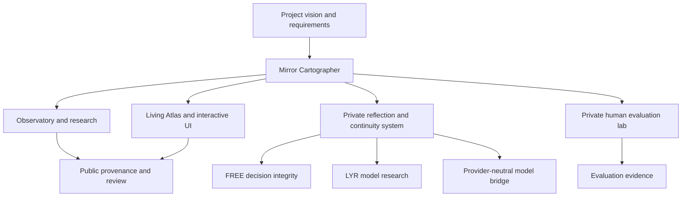

# Mirror Cartographer — public project system map

**Updated:** 2026-11-05

## Public-facing system

- **Observatory / research repository:** research framing, expeditions, project vocabulary, public evidence and review documents.
- **Mirror Cartographer UI:** interactive rooms, field instruments, visual experiments, Living Atlas, source workbench, and the local-first Unified Execution Hub at https://mirrorcartographer.github.io/mirror-cartographer-ui/execution-hub.html. Source: https://github.com/MirrorCartographer/mirror-cartographer-ui.

## Related private systems

The following are project components documented in private source repositories. Their source code and raw records are intentionally not copied into this public repository:

- **Repository C:** reflection engine, symbolic corpora, creative workshop, provider-neutral bridge, deterministic project inspection, bounded model worker, continuity and provenance records.
- **Human Judgment Lab (Repository J):** evaluation program, rubric, synthetic dataset, Consensus Trap experiment, and reproducibility tests.
- **FREE 2.0:** decision-integrity and governance workflow.
- **LYR:** independent language-model architecture, tokenizer, training and inference code; trained checkpoint not verified.

## Historical systems and artifacts

- **Canvas archive:** a bounded conversation export contains 39 unique Canvas textdoc IDs (32 document artifacts, 7 code artifacts), 695 metadata events, and 133 distinct `(textdoc_id, version)` pairs across 337 conversations dated 2024-08-22 through 2025-08-12 UTC. It is not the complete account history.
- **Google Apps Script prototype:** historical code constructed an OpenAI Chat Completions request for gpt-4; successful inference for a specific submission remains unverified.
- **Creation Portal / Image Organism:** procedural browser-side visual, audio, motion, and archive systems; these are not trained generative models.
- **Reflection prototypes:** Python/Streamlit, React, HTML, and JavaScript implementations across historical versions.

## Relationship diagram

## System boundary

This is a map of project relationships, not proof that every component is integrated or deployed. Public source can be independently inspected. Private components require owner-authorized access. Historical artifacts must be separately tested before being described as current runtime behavior.
