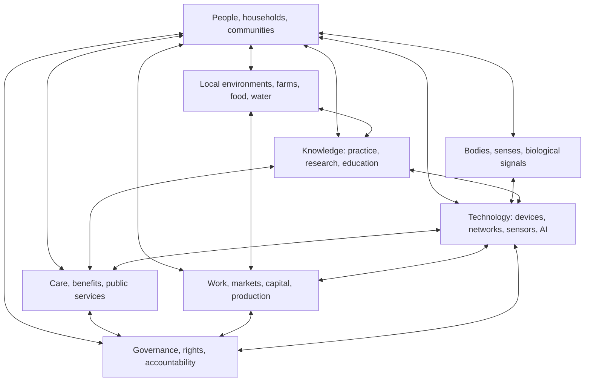

# Mirror Cartographer Systems Map of American Society
## A working model of relationships, flows, interfaces, and failure modes

**Originating project:** Charity Sturgell  
**Status:** Version 0.1 — research architecture, not a validated national model  
**Purpose:** Make cross-system relationships inspectable so that pilots can test where coordination creates public value.

---

## 1. The map is about flows, not just institutions

A conventional stakeholder map lists organizations. This map asks what actually moves between them, who can interpret it, who makes decisions, who bears the cost when a handoff fails, and whether useful feedback returns.

The system is composed of overlapping layers:

1. **People, households, and communities** — needs, choices, lived experience, relationships, skills, care, and local priorities.
2. **Bodies and sensory systems** — neural and muscular activity, perception, movement, fatigue, pain, interoception, communication, and biological variation.
3. **Local environments and production** — farms, food, water, housing, energy, transport, ecosystems, and physical work.
4. **Knowledge institutions** — schools, libraries, universities, laboratories, Cooperative Extension, professional practice, and community expertise.
5. **Care and public services** — healthcare, disability support, veteran services, benefits, social care, emergency response, and public administration.
6. **Work and economic exchange** — employers, workers, small businesses, markets, capital, wages, procurement, and value distribution.
7. **Digital and technical infrastructure** — telecommunications, devices, sensors, software, AI systems, data storage, standards, and cybersecurity.
8. **Governance and accountability** — laws, rights, public oversight, procurement rules, professional standards, consent, and remedies.

These layers are not a hierarchy. A person may be a producer, caregiver, patient, researcher, worker, artist, and community member at the same time.

## 2. System relationship diagram

The arrows indicate relationships to investigate, not claims that every connection is currently effective or equally powered.

## 3. What moves through the system

| Flow | Examples | Key question |
|---|---|---|
| Knowledge | Research findings, craft knowledge, local observation | Can knowledge reach the people able to use or challenge it? |
| Signals | Physiological, environmental, machine, and service measurements | What was measured, by whom, with what limits? |
| Decisions | Care plans, eligibility determinations, farm choices, work allocation | Who has authority, and who can appeal or correct? |
| Resources | Money, energy, materials, equipment, time | Who contributes, who benefits, and who carries risk? |
| Labor and care | Paid work, unpaid care, maintenance, community coordination | Where is invisible work accumulating? |
| Data | Records, sensor streams, forms, histories, models | Who controls access, retention, interpretation, and reuse? |
| Trust | Reliability, consent, legitimacy, relationships | What creates or damages trust over time? |
| Feedback | Outcomes, corrections, complaints, lived experience | Does the system learn, or merely collect reports? |

## 4. Interfaces and handoffs are where the map becomes useful

A system interface is any point where one person, institution, tool, or domain must translate information or responsibility for another.

Examples:
- a patient explaining lived function to a clinician;
- a veteran translating a complex history into several benefit applications;
- a farmer converting research into a practical decision under local weather, soil, labor, and financial constraints;
- a laboratory turning a sample into a result that a person or community can interpret;
- a body-worn sensor translating electrical or mechanical activity into a machine-readable signal;
- an AI system translating noisy signals into a prediction or proposed action;
- a public agency turning a rule into an accessible service pathway.

For every handoff, record: sender, receiver, purpose, information lost, time cost, decision rights, uncertainty, consent, failure recovery, and feedback destination.

## 5. Failure modes to investigate

These are hypotheses and audit prompts, not universal accusations.

- **Translation loss:** context, uncertainty, or local meaning disappears between systems.
- **Access mismatch:** a service assumes a device, broadband connection, literacy level, language, or physical ability.
- **Signal overreach:** a measurement is treated as a complete account of a person or environment.
- **Automation bias:** a model output is treated as authoritative despite uncertainty or poor fit.
- **Siloed accountability:** each component performs its narrow task while the person must repair the whole pathway.
- **Value extraction:** people supply data, labor, or attention without meaningful control or fair return.
- **Feedback failure:** errors are reported but do not change the system.
- **Centralization risk:** interoperability becomes a pretext for one actor to accumulate sensitive data or decision power.
- **Digital dependency:** access to essential participation becomes conditional on using a particular device or platform.
- **Unpaid coordination burden:** people and communities absorb the work of making disconnected systems function.

## 6. A screen-independent interaction layer

A crucial design principle: **the phone and computer are interfaces to electrical technology, not the only possible interfaces between humans and technological systems.**

Human bodies already rely on electrochemical signaling. Technology can interact with some aspects of that activity through measurement, stimulation, translation, and feedback. Other interfaces use sound, light, touch, movement, gaze, speech, environmental sensing, or physical controls. A person can interact with a technological system without looking at a screen or holding a phone.

The system map therefore includes a distinct interaction layer:
- **Input:** voice, gesture, gaze, movement, touch, pressure, physiological signals, environmental signals, switches, and assistive controls.
- **Interpretation:** signal processing, context, user-defined intent, AI-assisted pattern recognition, and explicit uncertainty.
- **Action:** information retrieval, communication, environmental control, robotic assistance, accessibility support, or a human-reviewed recommendation.
- **Feedback:** audio, tactile, visual, haptic, spatial, mechanical, or other sensory feedback.
- **Governance:** consent, reversibility, calibration, privacy, safety limits, and a clear way to stop or override the system.

This is not a claim that every modality is mature, safe, or suitable for every person. Each requires its own evidence and risk assessment.

## 7. AI's place in the map

AI is not the electrical interface, the sensor, the body, or the source of truth. It is a computational layer that may help:

1. combine heterogeneous signals while preserving their provenance;
2. identify patterns in noisy, nonlinear, or changing data;
3. adapt a system to an individual's baseline rather than assume one universal pattern;
4. translate between modalities, such as speech, text, gesture, and structured records;
5. generate candidate explanations and expose competing interpretations;
6. coordinate a feedback loop under explicit human-defined constraints;
7. summarize what changed, what remains unknown, and why an action was suggested.

The risks are equally central: false inference, model drift, bias, overconfidence, surveillance, opaque decisions, and automation that removes human control. AI should make uncertainty and alternatives more visible, not conceal them behind fluent output.

## 8. Outcomes to measure

A pilot should measure more than clicks, adoption, or model accuracy.

- time and effort required to complete a task;
- errors, omissions, and successful recovery;
- access across device, connectivity, disability, language, and geography;
- whether people understand and can challenge system outputs;
- agency, privacy, and perceived control;
- quality and durability of decisions;
- distribution of benefits and burdens;
- effects on local expertise and institutional capacity;
- unintended harms and who bears them.

## 9. First bounded pilots

**Pilot A — Research-to-community translation.** Work with one Cooperative Extension partner and a local producer/community group on a bounded soil, water, or crop question. Map observations, lab measurements, published evidence, local constraints, decisions, and outcomes. Compare the current pathway with a co-designed handoff map. Do not assume a new platform is needed.

**Pilot B — Public-service handoff.** With a willing service organization, map one non-sensitive, bounded navigation pathway from eligibility information to a completed service. Measure repeated data entry, unclear instructions, delays, corrections, and user effort. Do not collect private case files in the public project.

**Pilot C — Screen-independent interaction.** Prototype a low-risk interaction in which a person can receive and provide information through a non-screen modality—such as audio, a physical switch, or haptic feedback. Physiological sensing or stimulation belongs in a separately reviewed research protocol, not an informal public demo.

## 10. What would falsify or weaken the proposal?

The model should be revised if:
- coordination layers add more burden than they remove;
- local knowledge is not improved by the proposed handoffs;
- interoperability increases surveillance or concentrates power;
- the measured benefit is limited to already advantaged participants;
- existing institutions solve the problem more effectively without a new layer;
- the apparent gains disappear when long-term costs and maintenance are included.

## 11. Research status

This is a working systems map. It is not a complete model of the United States, a causal account of social problems, or proof that one architecture can solve them. The next step is domain-specific mapping with affected communities, subject-matter experts, source-linked claims, and measurable pilots.

---

## Related work

Follow how research discovery connects to public systems and real-world capability in the [Connection Map](CONNECTION_MAP_RESEARCH_BIOLOGY_TECHNOLOGY_SOCIETY.md).
